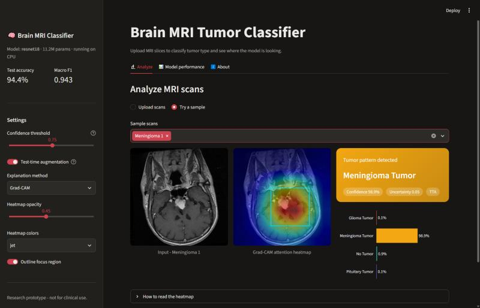
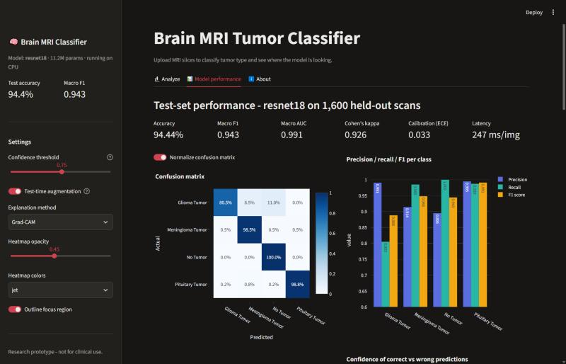
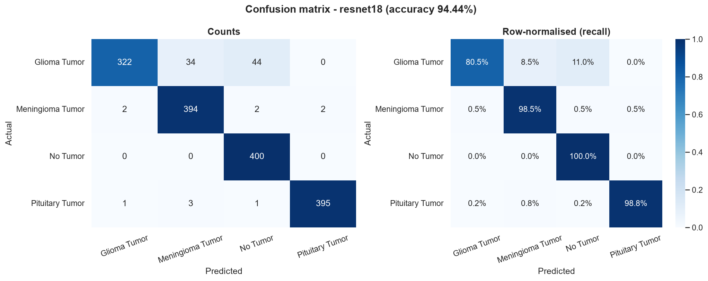
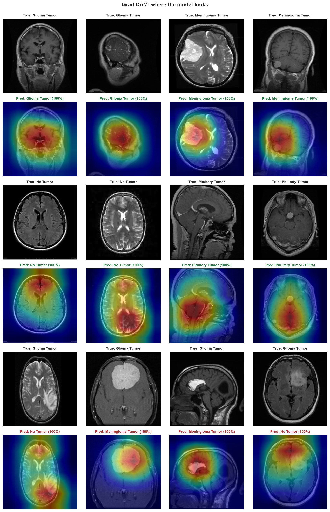
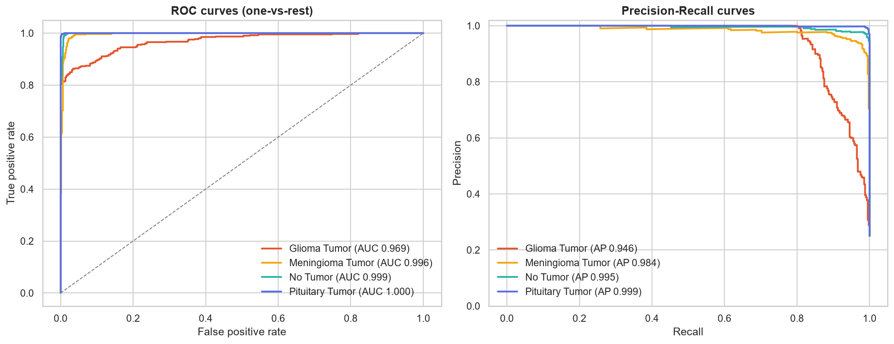
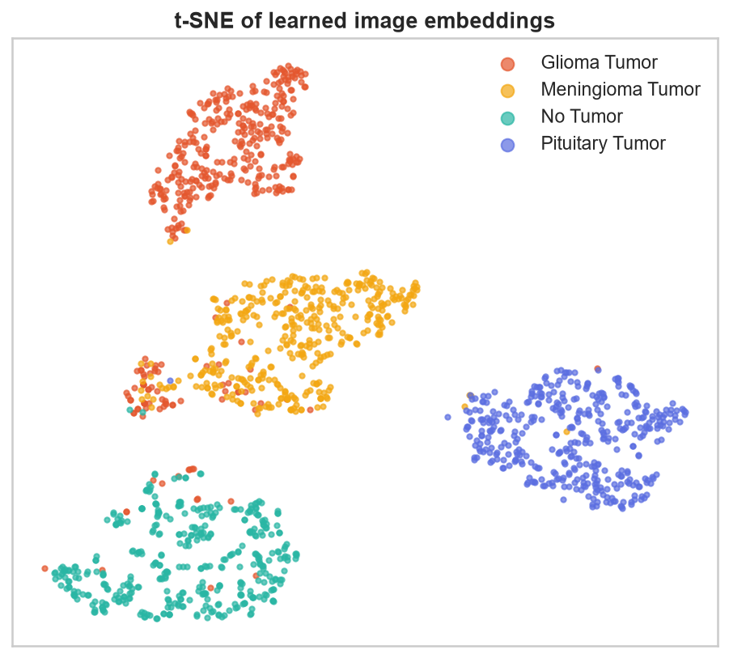
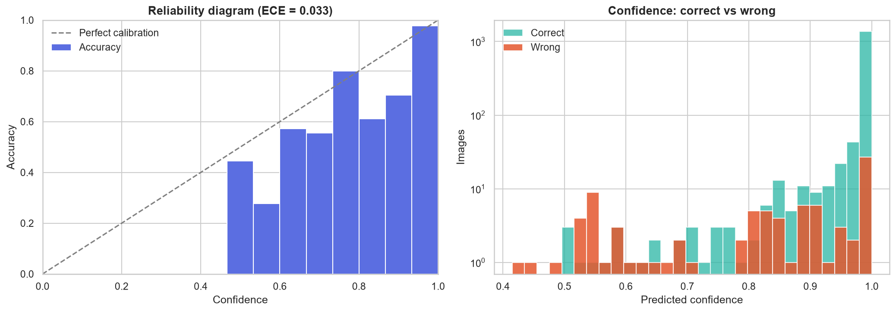

# 🧠 Brain MRI Tumor Classifier with Explainable AI

Deep-learning system that classifies 2D brain MRI slices into **glioma**, **meningioma**, **pituitary tumor** or **no tumor**, and shows **where the model is looking** with Grad-CAM heatmaps. It includes a full training and evaluation pipeline, an interactive Streamlit app with a model-performance dashboard, and tests.

<p align="center">
  
  
</p>

## Results

Current model: **ResNet18** fine-tuned from ImageNet, evaluated on the **1,600-image held-out test set** with test-time augmentation.

| Accuracy | Macro F1 | Macro ROC-AUC | Cohen's κ | Calibration error (ECE) | CPU latency |
|:-:|:-:|:-:|:-:|:-:|:-:|
| **94.4%** | **0.943** | **0.991** | 0.926 | 0.033 | ~250 ms/image |

| Class | Precision | Recall | F1 | AUC |
|---|:-:|:-:|:-:|:-:|
| Glioma | 0.991 | 0.805 | 0.888 | 0.969 |
| Meningioma | 0.914 | 0.985 | 0.948 | 0.996 |
| No tumor | 0.895 | 1.000 | 0.945 | 0.999 |
| Pituitary | 0.995 | 0.988 | 0.991 | 1.000 |

**Main weakness:** 11% of gliomas are predicted as "no tumor". In a clinical setting that is the most costly error, a missed tumor. The retraining pipeline below targets it with a leakage-free validation split, stronger augmentation and model comparison. The current checkpoint was trained before those fixes, so its test score is slightly optimistic; rerun the notebook for clean numbers.

<p align="center">
  
</p>

## Explainability: Grad-CAM

Each prediction comes with a Grad-CAM (or Grad-CAM++) heatmap from the last convolutional block. Correct tumor predictions focus on the lesion; the bottom row shows the model's most confident mistakes, which helps explain *why* it failed.

<p align="center"></p>

<p align="center">
  
</p>
<p align="center">
  
  
</p>

## Features

**Streamlit app** (`App.py`)
- Upload one or many MRI slices, or try the built-in samples
- Prediction card with confidence, predictive entropy (uncertainty) and test-time augmentation
- Grad-CAM / Grad-CAM++ heatmap overlay with adjustable opacity and colormap, plus an outlined focus region
- Batch mode: summary metrics, results table, class breakdown chart and CSV export
- Safety checks: confidence threshold, uncertainty score and a grayscale check that flags photos that are not MRI scans
- Model-performance dashboard: interactive confusion matrix, per-class metrics, ROC curves, confidence histograms, training curves and a diagnostics gallery

**Training pipeline** (`brain_mri/`, `notebooks/`)
- **Leakage check:** perceptual hashing finds test images duplicated in the training set and removes them
- **Proper model selection:** stratified train/validation split; checkpoints and early stopping use validation macro F1, and the test set is used only once
- Transfer learning with **ResNet18, ResNet50, EfficientNet-B0 or ConvNeXt-Tiny**
- Frozen-backbone warm start, AdamW with a lower backbone learning rate, warmup + cosine schedule, label smoothing, gradient clipping, mixed precision
- Augmentation: random resized crop, flips, affine transforms, brightness/contrast jitter, random erasing
- Evaluation: accuracy, macro F1, ROC-AUC, Cohen's κ, expected calibration error, reliability diagram, t-SNE embeddings, Grad-CAM grids and a gallery of the most confident mistakes
- Versioned checkpoints that store architecture, preprocessing, metrics and training history (older plain `state_dict` files still load)

## Project structure

```
App.py                      Streamlit app
brain_mri/
├── config.py               Classes, paths, training config
├── data.py                 Dataset, splits, augmentation, duplicate detection
├── models.py               Model factory, checkpoint save/load
├── train.py                Training loop
├── evaluate.py             Metrics and calibration
├── gradcam.py              Grad-CAM / Grad-CAM++
├── inference.py            Predictor used by the app
└── visualize.py            All report figures
scripts/
├── train.py                CLI training
└── evaluate.py             CLI evaluation -> reports/
notebooks/
└── Brain_MRI_Training.ipynb  End-to-end Colab notebook
models/best_model.pth       Trained weights
reports/                    Metrics, predictions and figures
tests/                      pytest suite
```

## Run the app

```bash
python -m venv .venv
.venv\Scripts\activate              # macOS/Linux: source .venv/bin/activate
pip install -r requirements.txt
streamlit run App.py
```

## Retrain the model

**Colab (recommended, free GPU):** open [`notebooks/Brain_MRI_Training.ipynb`](notebooks/Brain_MRI_Training.ipynb) in Colab, select a T4 GPU and run all cells (about 30 minutes). It downloads the dataset, trains and compares ResNet18 and EfficientNet-B0, generates every figure, and downloads `brain_mri_artifacts.zip`. Unzip it into this folder and commit.

**Locally, from the command line:**

```bash
pip install -r requirements-dev.txt
python scripts/train.py --data-dir path/to/dataset --arch efficientnet_b0 --epochs 20
python scripts/evaluate.py --checkpoint models/efficientnet_b0_best.pth --test-dir path/to/dataset/Testing --tta
```

## Tests

```bash
pytest
```

The suite covers data splitting, duplicate detection, every architecture's forward pass, Grad-CAM, checkpoint compatibility, metrics and a full mini training run on synthetic images.

## Dataset

[Brain Tumor MRI Dataset](https://www.kaggle.com/datasets/masoudnickparvar/brain-tumor-mri-dataset) by Masoud Nickparvar (four classes, licensed CC BY 4.0). Sample images in `assets/samples/` come from this dataset.

## Disclaimer

This is a research and portfolio project, **not a medical device**. It must not be used for diagnosis or treatment decisions.
